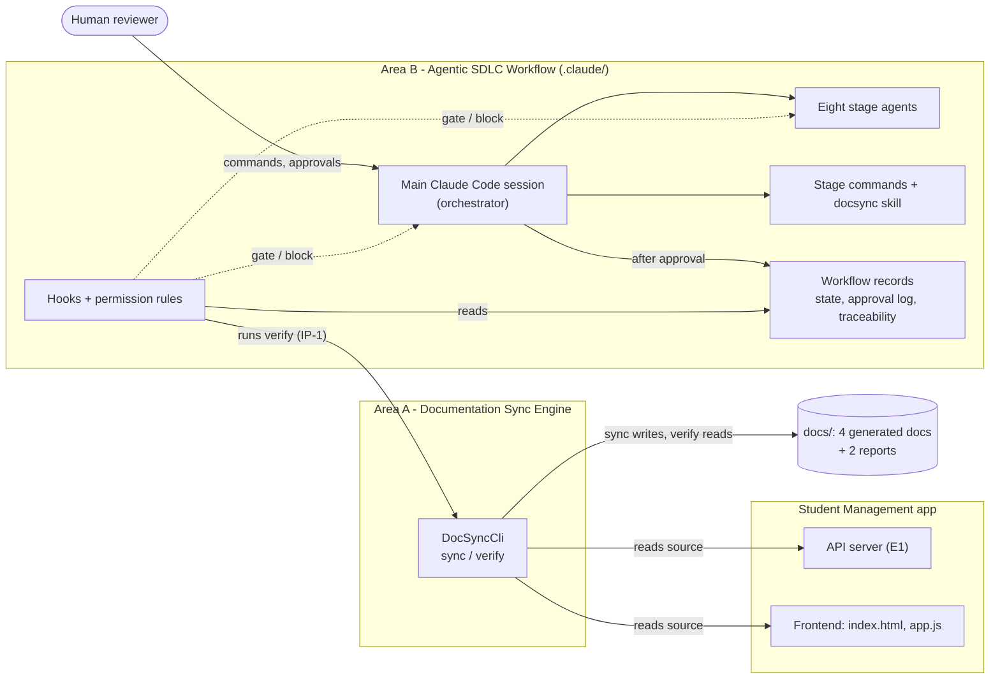
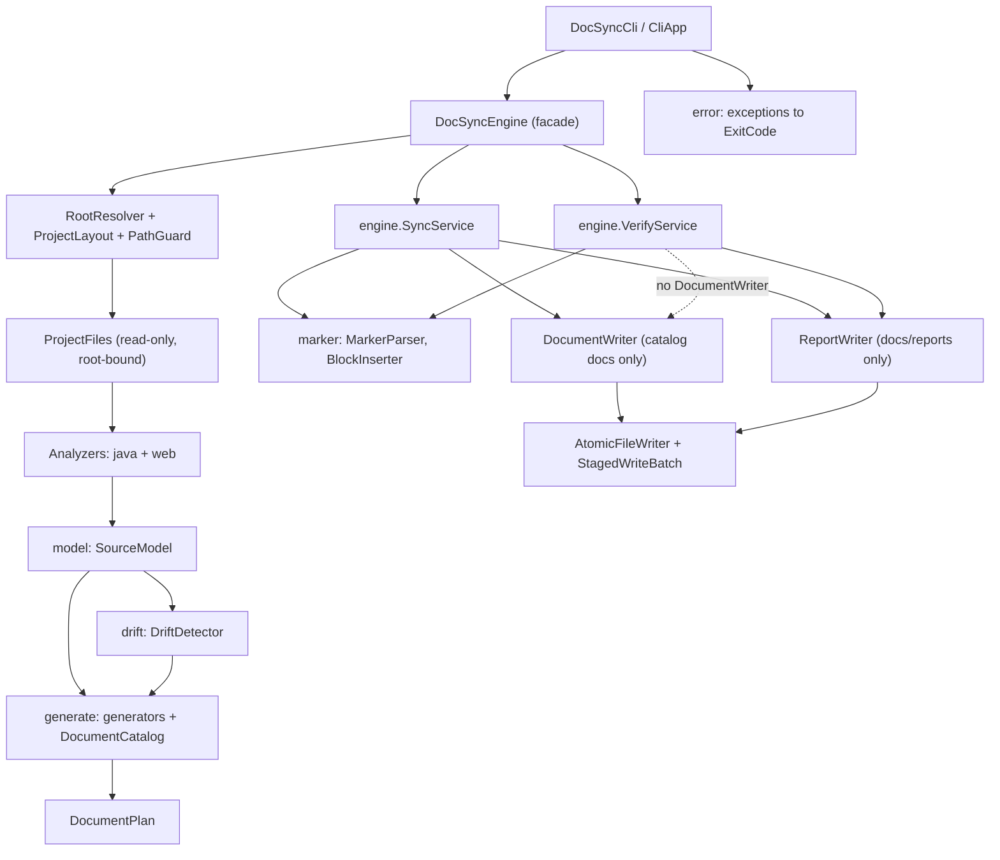
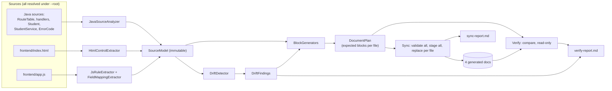
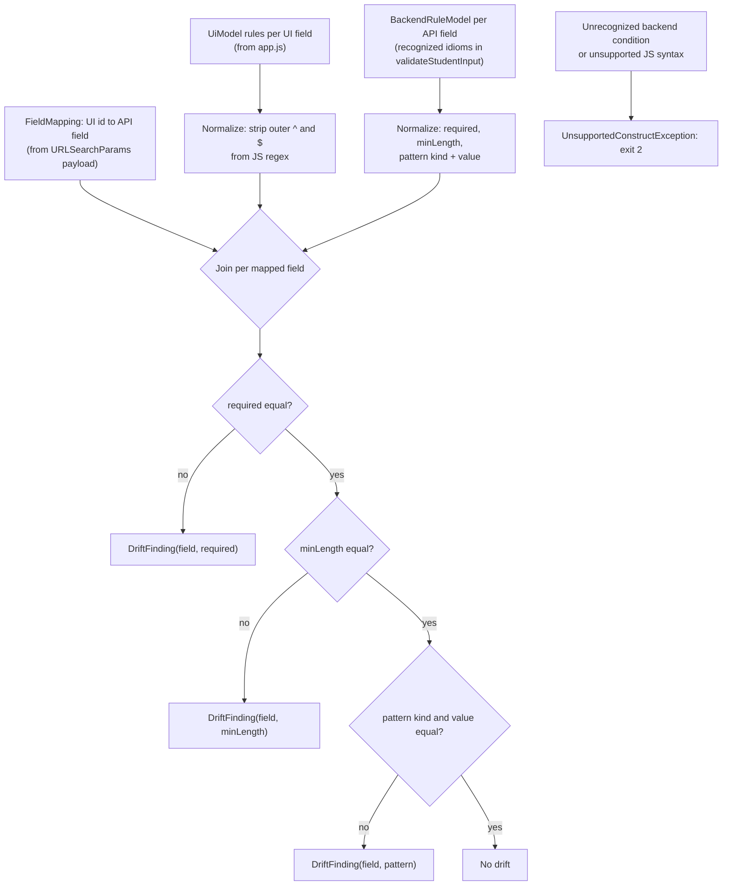
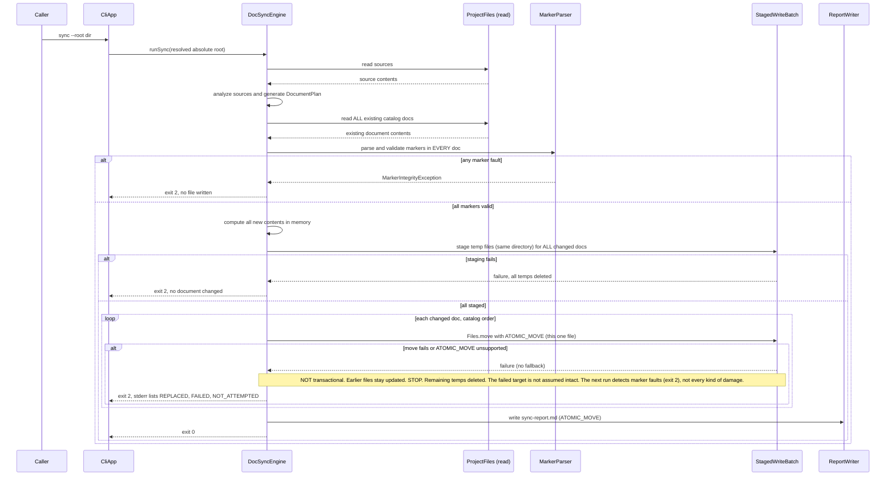
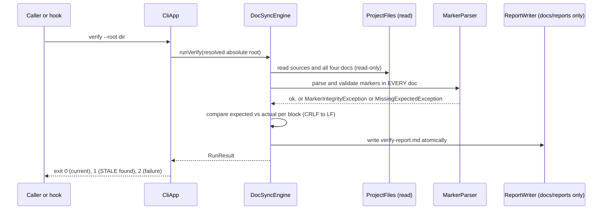
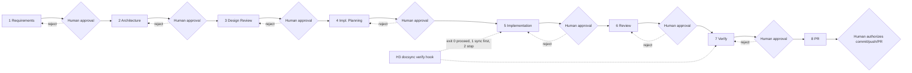
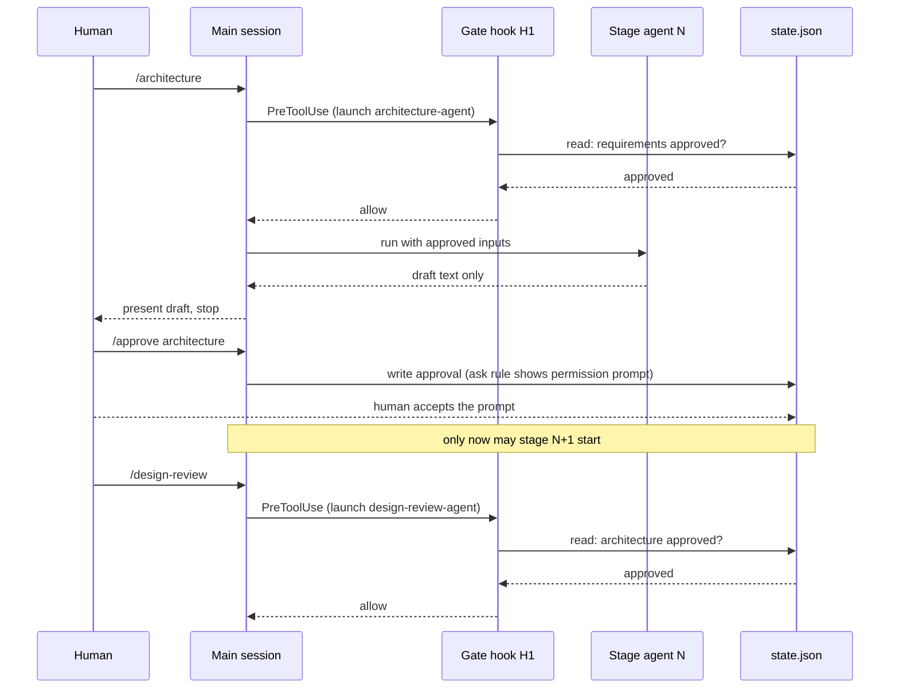

# ARCHITECTURE: Automated Documentation Sync, Agentic SDLC

**Status: APPROVED (final architecture proposal approved by the human on 2026-11-13). OI-01 remains OPEN by decision (D15).**

**File status:** approved content for `docs/architecture.md`. The verification spike (AD-18) has not been run, no implementation has started, and the Design Review phase has not started.

Based on: `docs/requirements.md` (HUMAN APPROVED, Revision 3 + D24 + D25), the README, `pom.xml`, all Java and frontend sources, and `.claude/agents/requirements-agent.md`. The original capstone assignment is not in the repository, so **OI-01 stays OPEN.**

Status keys: **Approved** = decided individually in the human's review. **Proposed** = included in this approved architecture and subject to Design Review and to the AD-18 gating where stated. **Open** = not decided.

## Review questions already answered

| Question | Answer | Recorded in |
|---|---|---|
| OQ-1 | Use the JDK Compiler Tree API. A full JDK is required at run time. | AD-01 |
| OQ-2 | Backend idiom recognizer. Don't modify validation logic to ease extraction. | AD-10 |
| OQ-3 | Preserve an existing file's line-ending style. LF for new files. | AD-04, 3.6 |
| OQ-4 | Explicit permission prompts for approval-record changes. | AD-12, 7.4 |
| OQ-5 | Run a verification spike during Design Review or Implementation Planning. | AD-18 |
| OQ-6 | Resolve a relative `--root` once at startup. No other component consults the working directory. | AD-16, 3.5 |
| OQ-7 | Include a Compiler Tree API parse-only smoke test in the spike, on the CodeMie JDK. | AD-18, R-01 |
| OQ-8 | Stop at the first replacement failure. Report REPLACED, FAILED and NOT_ATTEMPTED in catalog order. | AD-17, 3.7 |
| OQ-9 | Add the four atomic-move checks to the spike. AD-17 stays conditional. | AD-17, AD-18, R-19 |
| (corrections) | No non-atomic fallback. Distinguish API guarantees, platform behavior, spike observations and marker-only integrity. | AD-17, 3.7, R-07, R-19 |

# 1. Architecture Overview

## 1.1 Two separate areas, one integration point

| | Area A: Documentation Sync Engine and API | Area B: Agentic SDLC Workflow |
|---|---|---|
| What it is | The application: E1 API fixes plus the `docsync` CLI (E2, E3) | The process that builds and governs it, under `.claude/` |
| Technology | Java 17, JDK-only runtime, JUnit 5 | Markdown agents, commands and skills, `settings.json`, hook scripts |
| Integration | `DocSyncCli verify` exit codes 0, 1 and 2 | A hook reads those exit codes (IP-1) |



**Principles:** keep it simple (one pipeline, immutable records, no frameworks). Fail rather than guess. Deterministic by construction. Verify is read-only by structure. No agent approves itself.

## 1.2 Compatibility with approved decisions D1 to D25 (checked, nothing weakened)

| Decisions | How the architecture honors them |
|---|---|
| D1, D2, D3 | README stays the target spec, README correction is a planned task (FR-DOC-01), workflow under `.claude/`, `.github/` unused |
| D4 | Marker format implemented exactly in the `marker` package (AD-04) |
| D5, D6 | Exit mapping at one boundary (AD-07). A missing expected file or block is exit 2 in verify, never STALE |
| D7 | Sync creates and appends and never repairs markers. Verify never writes docs and may write its report (AD-05, AD-16, AD-17) |
| D8, D9, D17, D23, D24, D25 | `RouteTable`, `Router`, structured errors, 404 and 405 rules, DELETE `{"deleted":true}` (AD-09) |
| D10, D20 | Report-only DRIFT, validation rules untouched (AD-10) |
| D11, D14, D15, D16 | Eight stage agents, generic gates only, OI-01 open (Area B) |
| D12 | JDK-only, deterministic, JUnit 5 (AD-06) |
| D13 | Out-of-scope items stay out |
| D18, D22 | Minimal `app.js` change, manual check EX-01 |
| D19, D21 | Root-relative inputs and outputs (AD-16) |

# 2. Existing System Analysis [EXISTING, verified in code]

**Structure.** One Maven module, one test-scope dependency (JUnit 5).
```
src/main/java/org/example/
  Main.java                  creates HttpServer(8000), calls attachRoutes
  api/StudentApiServer.java  routing, dispatch, JSON text, form parsing (139 lines)
  model/Student.java         record(id, name, email, department, phone, status)
  repository/StudentRepository.java   in-memory LinkedHashMap
  service/StudentService.java         validation + create/get/list/delete
frontend/ index.html, app.js, style.css
src/test/java/org/example/   empty directories, no tests
```

**Current request flow**
```
Browser form --(POST /students, form-urlencoded)--> HttpServer
  context "/" (catch-all) | "/style.css" | "/app.js" -> read frontend/ file, 200, any method
  context "/students"  -> switch(method): GET list | POST create | else 405
  context "/students/" -> switch(method): GET one  | DELETE     | else 405
POST -> readForm/parseForm -> SERVICE.createStudent -> validateStudentInput
        IllegalArgumentException -> 400 {"error":"Invalid student input"}   (message discarded)
        ok -> 201 Student.toString()   (record syntax, not JSON)
```

**Responsibilities.** `StudentApiServer` does all HTTP work: routing, parsing, serialization and errors. `StudentService` validates, assigns an 8-character UUID id, trims values, sets status "active" and delegates. `StudentRepository` stores and looks up only.

**Validation today.** The frontend (`app.js:1-21`) checks name min 2, an email regex, department required and a phone regex. The backend (`StudentService.java:41-52`) checks name non-blank, email contains `@`, department non-blank and the same phone regex. Only the backend is enforced. The frontend alerts the first error.

**Limitations:**
- Routes are defined twice and the second list is unused.
- Bodies are not JSON.
- Errors are inconsistent.
- The `/` catch-all returns `index.html` for unknown paths.
- The service is a static singleton and the port is hard-coded.
- Static handlers ignore the method.
- Frontend files are read from the working directory.
- There are no tests.
- No `docsync` code or generated docs exist, and `.claude/` holds one agent file.

Everything from Section 3 onward is **proposed**.

---

# AREA A: APPLICATION ARCHITECTURE

# 3. Application Architecture

## 3.1 E1: restructure the API (prerequisite)

| Piece | Responsibility |
|---|---|
| `RouteTable` | The single source of truth. `routes()` holds the 4 API routes with literal arguments, such as `new Route("GET","/students","List all students","none","Student[]", handler)`. `staticRoutes()` holds `/`, `/style.css` and `/app.js`, GET-only. |
| `Router` | One `HttpHandler` at `/` with **exact** matching (with `{id}` templates). Unknown path gives 404. Known path with an unsupported method gives 405. Handler exceptions give a structured 500 (trigger policy open, OI-06). |
| `JsonWriter`, `ErrorCode` enum | Hand-written JSON, no library. `ErrorCode` holds codes and statuses so the engine can document them (FR-E1-11). A successful DELETE writes exactly `{"deleted":true}` with 200. |
| `StudentApiServer(service, port)` | Constructor-injected service and port. `Main` wires them. Port 0 gives tests a free port. |

Routing in one `/` context means correctness doesn't depend on the JDK's context prefix matching, which I haven't verified (OI-18).

## 3.2 The engine pipeline

```
 --root, command
      │
 [CliApp] ─► [RootResolver: resolve --root once] ─► [ProjectLayout: root-bound paths]
                                │
                      [ProjectFiles (read-only)] ─► LF-normalized text
                    ┌───────────┴────────────┐
             [JavaAnalyzer]            [WebAnalyzer]
                    └───────────┬────────────┘
                         SourceModel (immutable)
                                │
                         [DriftDetector] ─► DriftFindings
                                │
                         [Generators x catalog] ─► DocumentPlan
                    ┌───────────┴────────────┐
             [SyncService]             [VerifyService]
        ProjectFiles + DocumentWriter   ProjectFiles + ReportWriter only
        + ReportWriter                  (no DocumentWriter exists here)
                    └───────────┬────────────┘
                         [ReportRenderer] ─► docs/reports/*.md
                                │
                         [ExitCode mapping] ─► 0 / 1 / 2
```

**How it does each required thing**
- **Read:** every read goes through `ProjectFiles`, bound to the resolved root (3.5). The Java analyzer receives text, never a path.
- **Extract:** Java via the JDK Compiler Tree API (approved). HTML and JS via small restricted-subset parsers.
- **Represent:** immutable records (3.4).
- **Generate:** pure functions from model to Markdown block text.
- **Update without touching manual text:** documents become segments (manual text, block). Only block segments are replaced.
- **Verify without modifying:** `VerifyService` has no `DocumentWriter`, and its `ReportWriter` can only write under `docs/reports/`.
- **Detect drift:** both sides are normalized to one rule shape and compared per mapped field.

## 3.3 Package structure (new code under `org.example.docsync`)

```
org.example.docsync
  DocSyncCli                 main(): System.exit(CliApp.run(args, out, err))   (FR-E2-01)
  cli/        CliApp, ArgumentParser, Command(SYNC,VERIFY), CliOptions, ExitCode
  config/     ProjectLayout (logical doc/report/source names -> root-relative paths), RootResolver
  io/         ProjectFiles (read-only view), DocumentWriter (limited to catalog docs),
              ReportWriter (limited to docs/reports/), AtomicFileWriter, StagedWriteBatch, PathGuard
  analysis/
    java/     JavaSourceAnalyzer, RouteExtractor, FormParamExtractor, ServiceExtractor,
              RecordExtractor, ErrorCodeExtractor, BackendRuleExtractor (idiom recognizer), SourceDigest
    web/      HtmlControlExtractor, JsRuleExtractor (restricted-subset lexer), FieldMappingExtractor
  model/      SourceModel, ApiModel, RouteInfo, ContractModel, ServiceModel,
              UiModel, ControlInfo, RuleSpec, FieldMapping, BackendRuleModel
  drift/      DriftDetector, RuleComparator, DriftFinding
  generate/   BlockGenerator (interface), EndpointsDocGenerator, ContractDocGenerator,
              ServiceDocGenerator, UiDocGenerator, DocumentCatalog, DocumentPlan,
              GeneratedBlock, MarkdownTables
  marker/     MarkerFormat, MarkerParser, MarkedDocument, Segment, BlockInserter, LineEnding
  engine/     DocSyncEngine (facade), SyncService, VerifyService, StaleFinding, RunResult
  report/     SyncReport, VerifyReport, ReportRenderer
  error/      DocSyncException + UsageException, RootException, MarkerIntegrityException,
              MissingExpectedException, UnsupportedConstructException,
              SourceReadException, DocumentWriteException (carries per-file outcomes)
```
The test tree mirrors this. No new dependency is added.

## 3.4 Internal representation

`SourceModel` = `ApiModel` (routes, error codes) + `ContractModel` (Student fields, form parameters) + `ServiceModel` (public methods, source digest) + `UiModel` (controls, rules, mapping) + `BackendRuleModel`. `RuleSpec` is the shared comparison shape: `required`, optional `minLength`, optional `Pattern(kind=REGEX|CONTAINS, value)`. Findings are values (`StaleFinding`, `DriftFinding`). Failures are exceptions.

## 3.5 Root-relative path resolution (AD-16, OQ-6 approved)

`--root` is the only anchor.

1. **Resolve once, in one place.** `RootResolver` is the **only** component allowed to consult the launch directory. At startup it turns `--root` into an absolute, normalized, existing directory. A relative value such as `.` is resolved against the launch directory exactly once. A missing, unreadable or non-directory root gives exit 2. Every later source, documentation, report and project-file operation receives only the resolved absolute root. A static test scans engine sources for working-directory-dependent APIs and permits them only in `RootResolver`.
2. **Logical names, not paths.** `ProjectLayout` maps logical names (`API_ROUTES_SOURCE`, `FRONTEND_HTML`, `DOC_ENDPOINTS`, `REPORT_VERIFY`) to root-relative paths. No component builds a path from a string literal.
3. **Root-bound I/O.** `ProjectFiles`, `DocumentWriter` and `ReportWriter` are built with the resolved root, accept only logical names, and call `PathGuard`, which rejects any path that doesn't normalize to a location inside the root. Java sources, frontend sources, the four docs and both reports all pass through them.
4. **No ambient file access.** No `File`, `Path.of(relativeString)`, `user.dir` or classpath lookups appear in the engine. Java source text goes to the compiler API as in-memory source objects, so the compiler never searches the working directory, a classpath or a sourcepath.
5. **No machine-specific text in output.** Reports and docs show root-relative paths with `/` separators, never absolute paths.
6. **Proof.** AC-E2-13 and 14 run with a fixture root and decoy files in the launch directory, backed by the static scan.

The API server's own static file reading from `frontend/` is unrelated and unchanged (OBS-01, D19).

## 3.6 Marker synchronization and sync phases (AD-04)

Sync runs in seven ordered phases. **No target document is replaced before phase 6.**

| Phase | Action | On failure |
|---|---|---|
| 1 | Analyze sources into `SourceModel` | `UnsupportedConstructException` or `SourceReadException`, exit 2, nothing written |
| 2 | Generate `DocumentPlan` for every catalog file | exit 2, nothing written |
| 3 | **Validate before any write:** read **all** existing catalog docs (all four once E3 is delivered) and parse and validate markers in every one. A missing file is fine here, since it will be created. | `MarkerIntegrityException`, exit 2, **nothing written** |
| 4 | Compute all new file contents in memory | exit 2, nothing written |
| 5 | **Stage all changed files** as same-directory temp files **before any replacement starts** (3.7) | delete every temp file, exit 2, **no document changed** |
| 6 | Replace files one at a time with `ATOMIC_MOVE` only, in catalog order. **Not transactional across files.** | Stop at the first failure, clean up remaining temp files, exit 2, list REPLACED, FAILED and NOT_ATTEMPTED on stderr. No non-atomic fallback. |
| 7 | Write `sync-report.md` the same atomic way (whether a report is written after a failed run is open, OI-08) | exit 2 |

A marker fault anywhere is caught in phase 3, so it can never cause a partial documentation update.

**Line endings (approved, OQ-3).** `LineEnding` is detected per existing file: if the file contains CRLF the generated block text uses CRLF, otherwise LF. New files use LF. Text outside blocks is never rewritten, so it stays byte-identical. Verify normalizes CRLF to LF before comparing, so line-ending style never causes STALE. A second sync regenerates with the same detected style, so it is idempotent. Mixed-style files are a Design detail.

**Other behavior.** Missing file: create it with its blocks. File exists but a block is missing: append the block after the existing manual content. Markers are never repaired.

## 3.7 Atomic file writing (AD-17, conditional on the spike)

**This approach is conditional. Nothing relies on it until the AD-18 spike passes.**

### Guarantee boundaries

| Source of the statement | What it covers | What it does not cover |
|---|---|---|
| **Java API documentation** (`Files.move` with `ATOMIC_MOVE`) | The move is atomic if it succeeds. `AtomicMoveNotSupportedException` is thrown when atomicity isn't possible. Replacing an existing target is implementation-specific. | It does not document, for every possible failure, that the original is left intact. |
| **OS and filesystem** | Whether a rename is all-or-nothing and what happens on failure. This varies with the platform and with local, network or synced folders. | Not a Java guarantee. Can differ between environments. |
| **Spike observations** (AD-18) | What happened on the CodeMie JDK, Windows version, filesystem and path tested, for the representative failures tried. | Evidence about that environment and those cases only. |
| **Existing marker and STALE checks** (D6, D7) | They detect marker faults (exit 2) and differences in generated block content (STALE). | They are **not a general file-integrity check.** Valid markers do not prove the content is undamaged, and damage to text outside blocks is not detected. |

### What the next run can and cannot detect after a failed move

| State of the target after a failed move | Next `verify` | Next `sync` |
|---|---|---|
| Markers malformed, missing, unmatched or duplicated | exit 2 (integrity failure) | exit 2, nothing written, **never repaired** |
| Markers valid, generated block content damaged | `STALE`, exit 1 (the block differs from what the source generates) | regenerates that block, since sync replaces content only inside blocks, and reports the file "updated" |
| File missing | exit 2 (D6) | creates it (D7) |
| Markers and blocks valid, but manual text outside blocks damaged | **not detected**, because text outside blocks never affects the result | **not detected**, and preserved exactly as found |
| Anything else that leaves markers valid and block content correct | not detected | not detected |

**No new checksum, backup or recovery mechanism is part of this design.** Any such addition would be presented separately for approval.

### Procedure

1. **Skip unchanged files.** Equal bytes mean no temp file and no write.
2. **Create each temp file in the same directory as its target** (`Files.createTempFile(dir, ".docsync-", ".tmp")`), so the move is a same-filesystem rename. Missing parent directories are created first.
3. **Write fully** as UTF-8 and flush to disk (`FileChannel.force`, best-effort).
4. **Stage all changed files first.** No replacement starts until every temp file is written.
5. **Replace each file with `Files.move(temp, target, ATOMIC_MOVE)` only.**
   - **There is no fallback to an ordinary replace.**
   - If atomic replacement is unsupported or fails for any reason, it is a **replacement failure**.
   - A document is never written in place. It changes only through one rename operation.
   - **The engine does not assume that a failed move left the original intact.** It reports `FAILED` with the cause. What the next run can detect is limited to what its existing checks cover (table above).
6. **Failure while staging (phase 5):** delete every temp file, exit 2. **No document has changed.**
7. **Failure while replacing (phase 6):**
   - **The complete multi-file operation is not transactional.** Files replaced earlier **remain updated.**
   - The engine **stops at the first failure** (OQ-8) and does not attempt later files.
   - It deletes the remaining temp files where possible and exits 2.
   - stderr reports, **in catalog order, every file that needed replacement** as `REPLACED`, `FAILED` (with the cause) or `NOT_ATTEMPTED`. Files that were already unchanged are not listed.
8. **After a failure:**
   - Atomic replacement is expected to keep each document wholly old or wholly new. That is a platform property and a spike observation, not a Java API guarantee.
   - A re-run of `sync` validates every doc's markers first, then replaces the remaining changed files. Files already replaced compare equal and are "unchanged".
   - Detection is limited as in the table above.
   - Until a re-run, `verify` reports not-yet-replaced files as STALE (exit 1).
   - A temp file left by a hard crash is not a catalog file and is never read as a document. Its cleanup policy is a Design detail.
9. **Report-write failure (phase 7):** the docs are already updated and `sync-report.md` is not written. stderr says so, with exit 2. A recovery run's report lists only the changes that run made.
10. **If the spike fails (AD-18):** stop, present the evidence and alternative approaches for your approval. **No non-atomic fallback is introduced automatically.**

## 3.8 Verify behavior (AD-05)

1. Read the sources and all four docs read-only, and parse and validate **all** markers first. Any fault is exit 2 before staleness is evaluated.
2. A missing expected file or block is `MissingExpectedException`, exit 2, never STALE.
3. Compare expected and actual block content after CRLF to LF. Differences give a `StaleFinding` per file and exit 1. Text outside blocks never matters.
4. **Verify never modifies generated docs.** `VerifyService` has no `DocumentWriter`, and its `ReportWriter` is fenced by `PathGuard` to `docs/reports/`. AC-E2-09 hashes the four docs before and after.
5. Verify writes `verify-report.md` atomically, including when STALE is found.

## 3.9 Design patterns, justified

| Pattern | Where | Why |
|---|---|---|
| Pipeline | whole engine | Mirrors the requirements flow, and each stage is testable alone |
| Strategy (`BlockGenerator`) | doc generators | E3 adds the UI doc without touching E2 code |
| Immutable value objects | model, findings | Deterministic and easy to assert on |
| Facade (`DocSyncEngine`) | engine | The CLI stays thin and tests skip argument parsing |
| Visitor (`TreeScanner`) | Java analysis | The JDK API is already a visitor |
| Constructor injection | everywhere | Testability with no framework. Handing out only the capabilities a service needs (reader, writers) also enforces verify's read-only property. |
| One exception-to-exit-code boundary | `CliApp` | One place decides 0, 1 or 2 |

Deliberately not used: a Command class hierarchy, plugins, DI containers, a config file, an expression-evaluating JS interpreter.

# 4. Component Responsibilities

| # | Component | Responsibility | Inputs | Outputs | Depends on | Talks to |
|---|---|---|---|---|---|---|
| 1 | **CLI entry** `DocSyncCli` | `main` only | `String[]` | JVM exit status | `CliApp` | calls `CliApp.run` |
| 2 | **Command handling** `CliApp`, `ArgumentParser` | Parse `sync\|verify --root <dir>`. Reject unknown commands, unknown or missing arguments with usage on stderr. Dispatch. | args, out/err | `int` | config, engine, error | → `DocSyncEngine`; catches `DocSyncException` |
| 3 | **Configuration** `ProjectLayout` | Map logical names to root-relative paths for sources, 4 docs and 2 reports. No config file. | resolved root | root-bound locations | none | used by I/O classes |
| 4 | **`--root` resolution** `RootResolver`, `PathGuard` | Resolve `--root` once to an absolute directory (the only component that consults the launch directory). `PathGuard` rejects any path outside it. | raw arg | root `Path` or exit 2 | JDK `Path` | → `ProjectLayout`, I/O |
| 5 | **Java analyzer** | Parse in-memory source text, extract literal-only routes, form parameters, Student fields, service methods, error codes, backend rules, digest. Non-literal arguments or unrecognized validation conditions give exit 2. | source text | `ApiModel`, `ContractModel`, `ServiceModel`, `BackendRuleModel` | `ProjectFiles`, `jdk.compiler` | → `SourceModel` |
| 6 | **Frontend analyzer** | Extract controls, `validationRules` and payload mapping. Template literals or unsupported syntax give exit 2. | HTML and JS text | `UiModel` | `ProjectFiles` | → `SourceModel` |
| 7 | **API doc generator** | Routes and error-format blocks | `ApiModel` | blocks for `endpoints.md` | model | → `DocumentPlan` |
| 8 | **Contract doc generator** | Student fields and form parameters blocks | `ContractModel` | blocks for `student-contract.md` | model | → `DocumentPlan` |
| 9 | **Service doc generator** | Public methods and digest blocks | `ServiceModel` | blocks for `student-service.md` | model | → `DocumentPlan` |
| 10 | **UI doc generator** (E3) | Controls, rules, field mapping and drift blocks | `UiModel`, drift | blocks for `student-ui.md` | model, drift | → `DocumentPlan` |
| 11 | **Marker synchronization** | Seven-phase sync (3.6): validate all four docs' markers first, compute in memory, stage all, then replace per file with `ATOMIC_MOVE`. Not transactional across files. | `DocumentPlan`, existing files | per-file status, or per-file REPLACED/FAILED/NOT_ATTEMPTED on failure | `marker`, `io` | → `SyncReport` |
| 12 | **STALE detection** | Read-only parse and compare. Missing file or block, or any marker fault, is exit 2. | `DocumentPlan`, existing files | `StaleFinding` list | `marker`, `ProjectFiles` | → `VerifyReport` |
| 13 | **Drift detection** | Join UI and backend rules via `FieldMapping`, compare `required`, `minLength` and `pattern`. Message text and HTML-only limits never count. | `UiModel`, `BackendRuleModel` | `DriftFinding` list | `RuleComparator` | → UI generator, `VerifyReport` |
| 14 | **Sync report generator** | Created/updated/unchanged per file | file statuses | `docs/reports/sync-report.md` | `ReportRenderer`, `ReportWriter` | atomic write |
| 15 | **Verify report generator** | STALE files and DRIFT findings | findings | `docs/reports/verify-report.md` | `ReportRenderer`, `ReportWriter` | atomic write |
| 16 | **Error handling and exit codes** | `DocSyncException` subclasses give 2, stale results give 1, success is 0. Messages to stderr, never as STALE. | exceptions, `RunResult` | `ExitCode` | `error` | only in `CliApp` |
| 17 | **Atomic I/O** `AtomicFileWriter`, `StagedWriteBatch` | Same-directory temp staging and `ATOMIC_MOVE` replacement only, no fallback, cleanup, per-file outcomes (3.7). Conditional on AD-18. | target path, bytes | replaced files, or `DocumentWriteException` with outcomes | JDK `Files` | used by `DocumentWriter`, `ReportWriter` |

**Illustrative block IDs (pending OI-07, not final):** `api-routes`, `api-errors`, `contract-student-fields`, `contract-create-params`, `service-methods`, `service-digest`, `ui-controls`, `ui-rules`, `ui-field-mapping`, `ui-drift`. No source line numbers appear in generated text.



# 5. Data Flow




On current source this yields exactly two DRIFT findings: name (minLength) and email (pattern). Message text, select option lists, `maxlength` and input `type` never enter the comparison. Drift appears in the verify report and the UI doc but never changes the exit code (D10).

# 6. Sequence Diagrams




After a failed replacement, a re-run of `sync` is expected to complete the remaining replacements, and `verify` shows the not-yet-replaced files as STALE until then. No document writer exists in the verify path.

---

# AREA B: AGENTIC SDLC WORKFLOW ARCHITECTURE

# 7. Agentic SDLC Architecture

## 7.1 What Claude Code can enforce (official docs, via the guide agent)

| Fact | Consequence |
|---|---|
| Subagent `tools` can be limited to Read, Grep, Glob. Per-command Bash limits aren't a frontmatter feature. | Read-only agents. Bash limits come from `permissions` rules or a hook. |
| Subagents **can** spawn subagents unless `Agent` is left out of their tools. | Stage agents omit `Agent`, so the main session is the only orchestrator. |
| `PreToolUse` hooks can block (exit 2 or JSON deny) and get `tool_name`, `tool_input`, and `agent_id`/`agent_type` inside a subagent. Matchers see only the tool name. | Command and path filtering happens inside hook scripts. |
| Permission rules evaluate deny, then ask, then allow. `Edit(path)` also covers Write. | `ask` prompts give the human an explicit decision point. |
| `Stop` and `SubagentStop` hooks can block with exit 2. Exit 1 does not block. | The verify wrapper script must map failures to 2. |
| No built-in approval gate or stage state. | We build a state file plus hooks. |
| **Unconfirmed:** `agent_id` on the main thread, `PostToolUse` fields, the agent-launch tool name for the gate matcher, Windows hook shell behavior, `ask` under auto-accept modes. | To be verified by the spike (AD-18). |

## 7.2 Stages, agents and gates (agent names are proposals)

The stage list and "each stage has an agent" are approved (D11, D14). **Output names below are PROPOSED name-based candidates. The content of per-stage deliverables and handoff criteria stays OPEN under OI-01.** I define only the gating mechanism, which is the same for every stage.

| # | Stage | Proposed agent | Responsibility | Inputs | Output (candidate, unconfirmed) | Tools and permissions | Gate |
|---|---|---|---|---|---|---|---|
| 1 | Requirements | `requirements-agent` [EXISTING] | Elicit and document requirements | Repo, human answers | Draft text, candidate `requirements.md` | Read, Grep, Glob | Approved 2026-11-13 |
| 2 | Architecture | `architecture-agent` | Design both areas | Approved requirements | Draft text, candidate `architecture.md` | Read, Grep, Glob | Human approval recorded |
| 3 | Design Review | `design-review-agent` | Independently challenge the architecture | Approved architecture, requirements | Findings, candidate `design-review.md` | Read, Grep, Glob | Human triages findings, then approves |
| 4 | Implementation Planning | `impl-planning-agent` | Order the work, map tests | Approved architecture, design review | Plan, candidate `impl-plan.md` | Read, Grep, Glob | Human approves, which unlocks source edits |
| 5 | Implementation | `implementation-agent` | Code and tests per the approved plan | Approved plan | Code changes, tests | Read, Grep, Glob, Edit, Write, Bash with allowlist (`mvn`, `javac`, `java`), no git writes | Human authorizes moving on |
| 6 | Review | `review-agent` | Review the diff against requirements | Diff, plan | Code review evidence | Read, Grep, Glob, read-only git | Human triages findings (never auto-accepted) |
| 7 | Verify | `verify-agent` | Run tests and `DocSyncCli verify`, collect evidence | Code, reports | Test and verification evidence, EX-01 manual-check record | Read, Grep, Glob, Bash allowlist | Human approves evidence |
| 8 | PR | `pr-agent` | Draft PR text | Approved history | PR description draft | Read, Grep, Glob, read-only git | Human authorizes commit, push or `gh pr create` |

The changelog and reviewer checklist are known deliverables with no confirmed stage (OI-01). I don't place them. Seven of the eight agents have no direct Edit or Write tools. Explicitly allowlisted commands, such as `mvn` or `DocSyncCli verify`, may still create generated outputs such as `target/` files or reports. **The main session writes each artifact only after the human approves it**, the pattern `requirements-agent` already follows.

## 7.3 Building blocks

| Block | Role |
|---|---|
| `CLAUDE.md` (project root) | The two-area separation, never self-approve, read workflow state before acting, no commit or push without authorization, how to build and test. Custom subagents load it. (WF-03) |
| Custom agents | Eight definitions as above, minimal `tools`, no `Agent` tool (WF-01, WF-10) |
| Commands | One per stage plus `/approve`, `/reject` and `/workflow-status`. A stage command invokes its agent, shows the result, and stops. (WF-02) |
| Skill | `docsync`: when and how to run `sync` and `verify`, and what exit 0, 1 and 2 mean (WF-04, IP-2) |
| Hooks | **H1 stage gate** (`PreToolUse` on agent launch). **H2 write guard** (`PreToolUse` on Edit, Write, Bash). **H3 docsync verify** wrapper (WF-05). |
| Records | `state.json` (machine-readable), `approval-log.md` (append-only), `traceability.md` (WF-NFR-04). **Location and format are a proposal for OI-17.** |

## 7.4 Preventing progress without approval (AD-12)

1. **Gate hook H1.** Launching stage N is blocked unless stage N−1 is `approved` in the state file.
2. **Write guard H2.** Source edits are blocked until the plan is approved. Approved artifacts and the workflow records can't be edited outside the approval path.
3. **Explicit permission prompts on approval records (approved).** Writes to `state.json` and `approval-log.md` are `ask` rules, so recording an approval **requires the human to accept a visible permission prompt**. `/approve` has model invocation disabled. I use no hook that tries to read the human's typed text, since that feature is unconfirmed.
4. **`ask` and `deny` on git.** `git commit`, `git push` and `gh pr create` prompt. Force-push, merge and deploy are denied.
5. **Least privilege.** Only Implementation has direct Edit and Write tools. Its Bash access is allowlisted.

Rejection: `/reject <stage> <reason>` sets `revision_requested`, and the responsible stage must resubmit before the gate reopens (WF-NFR-03).

**State record sketch (format open, OI-17):** per stage, `status` (not_started, in_progress, awaiting_approval, approved, revision_requested, blocked), inputs, outputs, `approvedBy`, date, revision history.





**Integration with the engine (IP-1, IP-2, IP-3).** H3 runs `DocSyncCli verify --root <absolute project dir>` through a wrapper script. Exit 0 lets work proceed. Exit 1 reports stale documents and requires sync before proceeding. Exit 2 reports a tool or integrity failure and stops the affected workflow. The trigger event and who runs sync after exit 1 are **not decided (OI-11)**. Before `DocSyncCli` exists, the hook must say "engine not built" explicitly and not pass silently.

# 8. Proposed Project Structure

Status legend: **[EXISTING]** is present in the repository today. **[CHANGED]** exists today and receives only the minimal change stated. **[NEW]** is proposed and does not exist yet. Nothing marked [NEW] has been created. The names of proposed agents, commands and hook scripts are proposals. A dagger (†) marks a class role inferred from its name and the approved component rows, not separately specified in Sections 3 or 4.

## 8.1 Project tree

```
CLAUDE.md                                      [NEW] (WF-03)
README.md                                      [EXISTING] corrected after implementation (FR-DOC-01)
pom.xml                                        [EXISTING] unchanged: JDK-only, JUnit 5
frontend/
  index.html                                   [EXISTING] unchanged
  app.js                                       [CHANGED] minimal error-display change only (FR-E1-12)
  style.css                                    [EXISTING] unchanged
src/main/java/org/example/
  Main.java                                    [CHANGED] wires service, port, server
  api/
    StudentApiServer.java                      [CHANGED] StudentApiServer(service, port)
    RouteTable, Route, Router, JsonWriter,
    ErrorCode, handlers                        [NEW]
  model/ repository/ service/                  [EXISTING] rules unchanged, injectable seam only
  docsync/                                     [NEW] DocSyncCli, cli/, config/, io/,
                                               analysis/{java,web}/, model/, drift/, generate/,
                                               marker/, engine/, report/, error/
src/test/java/org/example/                     [EXISTING] empty directories today
                                               [NEW] api/, docsync/{cli,config,io,analysis/{java,web},model,drift,
                                               generate,marker,engine,report,error}/
docs/
  requirements.md                              [EXISTING] approved requirements
  architecture.md                              [EXISTING] this document
  codemie/analytics/                           [EXISTING] unrelated to this architecture
  api/endpoints.md, api/student-contract.md    [NEW] generated by sync (E2)
  backend/student-service.md                   [NEW] generated by sync (E2)
  ui/student-ui.md                             [NEW] generated by sync (E3)
  reports/sync-report.md, reports/verify-report.md   [NEW] written by sync and verify
  workflow/                                    [NEW] proposal for OI-17
.claude/
  agents/requirements-agent.md                 [EXISTING]
  agents/ (7 new stage agents)                 [NEW]
  commands/ (eight stage commands, approve, reject, workflow-status)   [NEW]
  skills/docsync/SKILL.md                      [NEW]
  hooks/ (gate-check, write-guard, docsync-verify scripts)   [NEW]
  settings.json                                [NEW] permissions + hook registration
```
Present in the repository but outside this architecture: `.github/` (unrelated Java-upgrade hook scripts, not used, D3), `.codemie/` (an empty directory), `target/` (git-ignored build output) and `.gitignore`.

## 8.2 Area A: packages and classes

| Package | Status | Classes and roles | Component or decision |
|---|---|---|---|
| `org.example` | CHANGED | `Main`: wires service, port and server, then starts the API | 3.1, FR-E1-10 |
| `org.example.api` | CHANGED and NEW | `StudentApiServer(service, port)`: constructor-injected service and port, port 0 for tests. `RouteTable`: single source of truth for the 4 API routes and the 3 static routes. `Route`: a route definition (today a nested record in `StudentApiServer`). `Router`: one handler at `/` with exact matching, 404, 405 and a structured 500. `JsonWriter`: hand-written JSON. `ErrorCode`: error codes and statuses, readable by the engine. Handlers: request handling for the routes (class names not fixed). | 3.1, AD-09, FR-E1-01 to 13 |
| `org.example.model` | EXISTING | `Student`: record, unchanged | Section 2 |
| `org.example.repository` | EXISTING | `StudentRepository`: in-memory store, unchanged | Section 2 |
| `org.example.service` | EXISTING, CHANGED | `StudentService`: validation rules unchanged, injectable seam only | Section 2, FR-E1-10, D10 |
| `org.example.docsync` | NEW | `DocSyncCli`: `main` only, calls `CliApp.run` | Section 4 row 1, FR-E2-01 |
| `...docsync.cli` | NEW | `CliApp` (command handling and the one exception-to-exit-code boundary), `ArgumentParser` (parses `sync\|verify --root <dir>`), `Command` (SYNC, VERIFY), `CliOptions`† (parsed arguments), `ExitCode` (0, 1, 2) | Section 4 rows 2 and 16, AD-07 |
| `...docsync.config` | NEW | `ProjectLayout` (logical names to root-relative paths), `RootResolver` (resolves `--root` once) | Section 4 rows 3 and 4, AD-16 |
| `...docsync.io` | NEW | `ProjectFiles` (read-only, root-bound), `DocumentWriter` (catalog docs only), `ReportWriter` (`docs/reports/` only), `PathGuard` (rejects paths outside the root), `AtomicFileWriter` and `StagedWriteBatch` (same-directory temp staging, `ATOMIC_MOVE` only, conditional on AD-18) | Section 4 rows 4 and 17, AD-05, AD-16, AD-17 |
| `...docsync.analysis.java` | NEW | `JavaSourceAnalyzer` (Compiler Tree API, parse-only), `RouteExtractor`†, `FormParamExtractor`†, `ServiceExtractor`†, `RecordExtractor`†, `ErrorCodeExtractor`†, `BackendRuleExtractor` (idiom recognizer), `SourceDigest`† | Section 4 row 5, AD-01, AD-10 |
| `...docsync.analysis.web` | NEW | `HtmlControlExtractor`†, `JsRuleExtractor` (restricted-subset lexer), `FieldMappingExtractor`† | Section 4 row 6 |
| `...docsync.model` | NEW | `SourceModel`, `ApiModel`, `RouteInfo`, `ContractModel`, `ServiceModel`, `UiModel`, `ControlInfo`, `RuleSpec`, `FieldMapping`, `BackendRuleModel`: immutable records | 3.4, AD-02 |
| `...docsync.drift` | NEW | `DriftDetector`, `RuleComparator`†, `DriftFinding` | Section 4 row 13, AD-10 |
| `...docsync.generate` | NEW | `BlockGenerator` (interface), `EndpointsDocGenerator`, `ContractDocGenerator`, `ServiceDocGenerator`, `UiDocGenerator` (E3), `DocumentCatalog`† (the managed docs), `DocumentPlan`, `GeneratedBlock`†, `MarkdownTables`† | Section 4 rows 7 to 10, AD-03, AD-08 |
| `...docsync.marker` | NEW | `MarkerFormat`†, `MarkerParser`, `MarkedDocument`†, `Segment` (manual text or block), `BlockInserter`†, `LineEnding` | 3.6, AD-04 |
| `...docsync.engine` | NEW | `DocSyncEngine` (facade), `SyncService` (seven-phase sync), `VerifyService` (read-only compare), `StaleFinding`, `RunResult`† | Section 4 rows 11 and 12, AD-04, AD-05 |
| `...docsync.report` | NEW | `SyncReport`, `VerifyReport`, `ReportRenderer` | Section 4 rows 14 and 15, OI-08 open |
| `...docsync.error` | NEW | `DocSyncException` and `UsageException`, `RootException`, `MarkerIntegrityException`, `MissingExpectedException`, `UnsupportedConstructException`, `SourceReadException`, `DocumentWriteException` (carries per-file outcomes) | Section 4 row 16, AD-07 |

The test tree mirrors the `docsync` packages, plus `api/` (3.3).

## 8.3 Area B: workflow configuration

| Location | Status | Contents | Maps to |
|---|---|---|---|
| `CLAUDE.md` (project root) | NEW | Two-area separation, never self-approve, read workflow state before acting, no commit or push without authorization, build and test commands. Custom subagents load it. | WF-03, 7.3 |
| `.claude/agents/` | `requirements-agent.md` EXISTING, seven stage agents NEW | `architecture-agent`, `design-review-agent`, `impl-planning-agent`, `implementation-agent`, `review-agent`, `verify-agent`, `pr-agent` (names are proposals). Each has minimal `tools` and no `Agent` tool. Per-stage deliverables and handoff criteria are not defined (OI-01). | WF-01, WF-10, 7.2, AD-11 |
| `.claude/commands/` | NEW | One command per stage, plus `/approve`, `/reject` and `/workflow-status`. Command names are not fixed (the 7.4 sequence diagram shows `/architecture` and `/design-review`). `/approve` has model invocation disabled. | WF-02, 7.3, 7.4 |
| `.claude/skills/docsync/SKILL.md` | NEW | When and how to run `sync` and `verify`, and what exit 0, 1 and 2 mean | WF-04, IP-2 |
| `.claude/hooks/` | NEW | `gate-check` (H1), `write-guard` (H2) and `docsync-verify` (H3) scripts. H3's trigger event is not decided (OI-11). Script behavior on Windows is to be verified by the spike. | WF-05, 7.3, 7.4, AD-12, AD-14, AD-18 |
| `.claude/settings.json` | NEW | Permission rules (`ask` and `deny` on approval records and git) and hook registration. Contents are not specified yet. | 7.4, AD-12 |
| `docs/workflow/` | NEW | `state.json`, `approval-log.md`, `traceability.md`. **Location and format are a proposal for OI-17.** | WF-NFR-01, 04, 06, AD-13 |

## 8.4 Separation of Area A and Area B

| Aspect | Area A: Documentation Sync Engine and API | Area B: Agentic SDLC Workflow |
|---|---|---|
| Where it lives | `src/main/java/`, `src/test/java/`, `frontend/`, and the generated docs and reports under `docs/api/`, `docs/backend/`, `docs/ui/`, `docs/reports/` | `.claude/`, `CLAUDE.md` and `docs/workflow/` |
| What it is | The application being developed | The process that develops and governs it |
| Requirements list | FR-E1, FR-E2, FR-E3, FR-DOC-01, NFR-01 to NFR-05 | WF-01 to WF-10, WF-NFR-01 to WF-NFR-06 |
| Built and tested with | Maven (`mvn test`), JUnit 5, JDK only | Not part of the Maven build. Hooks are scripts, and the spike (AD-18) checks their behavior. |
| Coupling (the only points) | IP-1: exposes `DocSyncCli verify --root <absolute project dir>` and its exit codes 0, 1 and 2 | IP-1: runs the CLI through H3. IP-2: the `docsync` skill documents `sync` and `verify`. IP-3 (proposed, unconfirmed): the Verify and PR stages cite `verify-report.md` and `mvn test` output as evidence. |

## 8.5 Conditional and unresolved details

| Item | Where it shows up in the structure | Status |
|---|---|---|
| JDK Compiler Tree API (AD-01) | `docsync.analysis.java`, `JavaSourceAnalyzer` | Approved. Not relied on until the AD-18 smoke test passes. |
| Atomic replacement (AD-17) | `docsync.io`, `AtomicFileWriter` and `StagedWriteBatch` | Conditional on the AD-18 spike. No non-atomic fallback. |
| Hooks and permission rules (AD-12, AD-14) | `.claude/hooks/`, `.claude/settings.json` | Mechanism approved (OQ-4). Behavior to be verified by the spike. |
| Hook trigger event (OI-11) | `.claude/hooks/` (`docsync-verify`) | Open |
| Record location and format (OI-17) | `docs/workflow/` | Open (proposal in AD-13) |
| Block IDs, per-file layout, digest format (OI-07) | `docs/api/`, `docs/backend/`, `docs/ui/` and `docsync.generate` | Open. The block IDs shown in Section 4 are illustrative. |
| Report content, failed-run report (OI-08) | `docsync.report`, `docs/reports/` | Open |
| Drift and route extraction details (OI-09) | `docsync.analysis`, `docsync.drift` | Direction set by AD-01, AD-09 and AD-10. Details open. |
| Request and delete-result contract source (OI-16) | `org.example.api` | Open. `StudentRequest` and `DeleteResponse` do not exist as classes. |
| Stage deliverables, handoff criteria, stage mapping (OI-01) | `.claude/agents/`, `.claude/commands/` | **Open.** Agent and command content is not defined. |
| `Allow` header, structured-500 trigger, HEAD and OPTIONS, prefix matching (OI-04, OI-06, OI-21, OI-18) | `Router`, `RouteTable` | Open |
| Manual `app.js` check procedure (OI-20) | `frontend/app.js` | Open |
| Names of agents, commands, hook scripts and handler classes | `.claude/`, `org.example.api` | Proposals, not fixed |

Generated docs are created by `sync`, not hand-written.

# 9. Architecture Decisions

Each decision gives its statement, rationale, consequences, related decisions, open items and approval status. D-numbers refer to `docs/requirements.md`. The D-lists are derived from the compatibility table in 1.2 and the traceability table in `docs/requirements.md`. Status terms are defined at the top of this document.

## 9.1 Decision index

| AD | Decision | Status | Condition or verification |
|---|---|---|---|
| AD-01 | Source analysis approach | Approved (OQ-1) | Not relied on until the AD-18 smoke test passes |
| AD-02 | Internal representation | Proposed | None |
| AD-03 | Documentation generation | Proposed | None |
| AD-04 | Marker-based synchronization | Proposed. Line-ending policy Approved (OQ-3). | The replacement part depends on AD-17 |
| AD-05 | STALE detection and read-only verify | Proposed | None |
| AD-06 | Deterministic output and idempotency | Proposed | None |
| AD-07 | Error handling and exit codes | Proposed | OI-08 open |
| AD-08 | Component separation | Proposed | None |
| AD-09 | E1 routing | Proposed | OI-04, OI-06, OI-18, OI-21 open |
| AD-10 | Drift detection and backend-rule extraction | Approved (OQ-2) | OI-09 details open |
| AD-11 | Agent orchestration | Proposed | OI-01 open |
| AD-12 | Human approval gates | Mechanism Approved (OQ-4), rest Proposed | Behaviors to be verified by AD-18 |
| AD-13 | Workflow state and traceability | Proposed | OI-17 open |
| AD-14 | Verify hook placement | **Open** (OI-11) | Not decidable until the spike |
| AD-15 | Report content and failed-run report | **Open** (OI-08) | None |
| AD-16 | Root-relative path resolution | Approved (OQ-6), mechanics Proposed | None |
| AD-17 | Atomic file writing | Proposed, **CONDITIONAL** | Do not implement or rely on until the AD-18 spike passes |
| AD-18 | Verification spike | Approved (OQ-5, OQ-7, OQ-9) | Runs during Design Review or Implementation Planning |

## 9.2 Decisions

### AD-01 Source analysis approach

- **Decision statement:** Java via the JDK Compiler Tree API in parse-only mode on in-memory source text. A full JDK is required at run time. HTML and JS via restricted-subset parsers that reject anything outside the subset.
- **Rationale:** No third-party libraries are allowed (NFR-01), and unsupported constructs must fail (FR-E2-04). A syntax tree gives exact literal detection and needs no classpath. Alternatives considered: regex scanning, a third-party parser, reflection on compiled classes.
- **Consequences and implementation implications:** Needs a JDK, not a JRE. The custom HTML and JS parsers carry edge-case risk. Implemented in `docsync.analysis.java` and `docsync.analysis.web` (8.2). Reliance is gated by the spike's smoke test (AD-18).
- **Related decisions and requirements:** D1, D5, D12. FR-E2-02, FR-E2-04, FR-E3-02, FR-E3-03, NFR-01.
- **Open items:** OI-09 (extraction details) stays open. Direction is set by AD-01, AD-09 and AD-10.
- **Approval status:** **Approved** (OQ-1). Not relied on until the AD-18 Compiler Tree API smoke test passes.

### AD-02 Internal representation

- **Decision statement:** Immutable records. Findings are values, failures are exceptions.
- **Rationale:** Deterministic and easy to assert on (3.9). Alternatives considered: raw text between stages, mutable beans.
- **Consequences and implementation implications:** More small classes. The model lives in `docsync.model` (3.4, 8.2).
- **Related decisions and requirements:** D6, D12. NFR-02, NFR-03, FR-E2-14.
- **Open items:** None.
- **Approval status:** **Proposed**.

### AD-03 Documentation generation

- **Decision statement:** Pure functions with code-embedded templates, source ordering, no line numbers or timestamps.
- **Rationale:** Generated output must be deterministic (NFR-02, NFR-03). Alternatives considered: external templates, a template engine.
- **Consequences and implementation implications:** Wording changes mean code edits. Generators live in `docsync.generate` (8.2). No source line numbers appear in generated text.
- **Related decisions and requirements:** D1, D6, D9, D12. FR-E2-22, FR-E1-11, NFR-02, NFR-03.
- **Open items:** OI-07 (block IDs, per-file layout, digest format) is related and stays open.
- **Approval status:** **Proposed**.

### AD-04 Marker-based synchronization

- **Decision statement:** Segment-based parsing. Seven-phase sync (3.6): validate every file's markers before any write, stage all changed files before any replacement, accept that replacement is per-file atomic but not transactional (AD-17). Never repair markers. Preserve each existing file's line-ending style for inserted text, LF for new files.
- **Rationale:** Manual text is provably untouched by sync, and a marker fault can't cause a partial update. Alternatives considered: regex replace in place, regenerate whole files.
- **Consequences and implementation implications:** A parser to build and test (`docsync.marker`). Block IDs are not final. Mixed line-ending styles in one file are a Design detail.
- **Related decisions and requirements:** D4, D6, D7, D12. FR-E2-05 to FR-E2-13, AC-E2-04 to AC-E2-07.
- **Open items:** OI-07 (block IDs).
- **Approval status:** **Proposed**. Line-ending policy **Approved** (OQ-3). The replacement part is conditional through AD-17.

### AD-05 STALE detection and read-only verify

- **Decision statement:** Compare normalized expected and actual blocks. A missing file or block is exit 2. `VerifyService` is built without a `DocumentWriter`, and `ReportWriter` is fenced to `docs/reports/`.
- **Rationale:** "Verify never modifies docs" holds by construction. Alternative considered: a dry-run flag on sync code.
- **Consequences and implementation implications:** Some duplication between sync and verify, shared through the facade. Implemented in `docsync.engine` and `docsync.io` (8.2).
- **Related decisions and requirements:** D5, D6, D7. FR-E2-14 to FR-E2-16, AC-E2-09.
- **Open items:** OI-08 (report content) is related and stays open.
- **Approval status:** **Proposed**.

### AD-06 Deterministic output and idempotency

- **Decision statement:** Ordered collections, explicit UTF-8, no clock, write only on change, root-relative paths in output, enforced by a test that runs sync three times.
- **Rationale:** Repeated sync runs with no changes must give byte-identical docs and reports (NFR-02, NFR-03).
- **Consequences and implementation implications:** A three-run test checks byte-identical output (AC-E2-07). No timestamps or absolute paths in any generated text.
- **Related decisions and requirements:** D7, D12. FR-E2-13, NFR-02, NFR-03, AC-E2-07.
- **Open items:** None.
- **Approval status:** **Proposed**.

### AD-07 Error handling and exit codes

- **Decision statement:** A `DocSyncException` hierarchy mapped to exit 2 at one boundary, STALE as a result value mapped to exit 1. `CliApp.run` returns an int and only `main` calls `System.exit`.
- **Rationale:** One place decides 0, 1 or 2 (3.9), so exit codes stay consistent and predictable for agents, hooks and CI (D5).
- **Consequences and implementation implications:** The `docsync.error` package holds the hierarchy, including `DocumentWriteException` with per-file outcomes (8.2). Whether an exit-2 run writes a report is not decided.
- **Related decisions and requirements:** D1, D5, D6. FR-E2-17, FR-E2-18, AC-E2-01, AC-E2-05.
- **Open items:** OI-08 (whether exit 2 writes a report).
- **Approval status:** **Proposed**.

### AD-08 Component separation

- **Decision statement:** One-way dependencies: analysis and model, then generate, then engine, then cli. About 11 small packages, accepted for testability. E3 is an additive increment.
- **Rationale:** Each stage is testable alone, and E3 adds the UI doc without touching E2 code (3.9).
- **Consequences and implementation implications:** Many small packages. The layout is in 3.3 and 8.2.
- **Related decisions and requirements:** D1, D4 to D7, D12. FR-E2-03, FR-E3-01, NFR-04.
- **Open items:** None.
- **Approval status:** **Proposed**.

### AD-09 E1 routing

- **Decision statement:** `RouteTable` plus an exact-match `Router` at `/`. API routes are documented and static routes dispatched only.
- **Rationale:** Correctness doesn't depend on the JDK's context prefix matching (3.1). Alternatives considered: keep per-path contexts, a web framework (breaks NFR-01).
- **Consequences and implementation implications:** A modest rewrite of `StudentApiServer`. New classes in `org.example.api` (8.2).
- **Related decisions and requirements:** D8, D9, D17, D23, D24, D25. FR-E1-01, FR-E1-06, FR-E1-07, FR-E1-10, FR-E1-13. Gaps G-05, G-08, G-18.
- **Open items:** OI-04 (`Allow` header), OI-06 (structured-500 trigger), OI-18 (prefix matching, unverified) and OI-21 (HEAD and OPTIONS) stay open. OI-16 (contract source) is related and open.
- **Approval status:** **Proposed**.

### AD-10 Drift detection and backend-rule extraction

- **Decision statement:** Normalize both sides to `RuleSpec`. The backend side uses an idiom recognizer on `validateStudentInput`. An unrecognized condition is exit 2. Existing validation logic is **not** modified for extraction.
- **Rationale:** No application change is needed. Alternatives considered: refactor to a declarative table (rejected), compare regex text only.
- **Consequences and implementation implications:** A new validation style breaks extraction until it is taught. The mitigation is tests per idiom. Implemented in `docsync.analysis.java` (`BackendRuleExtractor`) and `docsync.drift`.
- **Related decisions and requirements:** D10, D20. FR-E3-05 to FR-E3-09, AC-E3-04, AC-E3-05.
- **Open items:** OI-09 (extraction details).
- **Approval status:** **Approved** (OQ-2).

### AD-11 Agent orchestration

- **Decision statement:** Flat topology. The main session orchestrates, stage agents lack the `Agent` tool, and each stage command runs one agent and stops.
- **Rationale:** An approval gate sits between every pair of stages. Alternative considered: a coordinator agent chaining stages, which could skip gates.
- **Consequences and implementation implications:** More manual commands. The agents and commands are in `.claude/` (8.3).
- **Related decisions and requirements:** D11, D14, D15. WF-01, WF-02, WF-06.
- **Open items:** OI-01 (stage deliverables, handoff criteria and stage mapping) stays open, and agent and command content is not defined.
- **Approval status:** **Proposed**.

### AD-12 Human approval gates

- **Decision statement:** The five layers in 7.4: the gate hook H1, the write guard H2, permission prompts on approval records, `ask` and `deny` on git, and least privilege. Approval recording uses explicit permission prompts.
- **Rationale:** Alternatives considered: agent prompt text only, a single hook.
- **Consequences and implementation implications:** Hooks are best-effort, and some behaviors are unconfirmed (AD-18). Implemented in `.claude/hooks/` and `.claude/settings.json` (8.3).
- **Related decisions and requirements:** D5, D11, D16. WF-05, WF-06, WF-07, WF-NFR-02, WF-NFR-05, AC-WF-05, AC-WF-06.
- **Open items:** OI-11 (hook trigger) and OI-17 (record location and format) stay open.
- **Approval status:** Mechanism **Approved** (OQ-4), the rest **Proposed**. The unconfirmed behaviors are to be verified by the AD-18 spike.

### AD-13 Workflow state and traceability

- **Decision statement:** `state.json`, `approval-log.md` and `traceability.md` under `docs/workflow/`.
- **Rationale:** The workflow needs stage records, approval records and traceability (WF-NFR-01, WF-NFR-04, WF-NFR-06). Alternatives considered: state only in chat, git history only.
- **Consequences and implementation implications:** Three files to keep consistent.
- **Related decisions and requirements:** D16. WF-NFR-01, WF-NFR-04, WF-NFR-06.
- **Open items:** OI-17. Format and location are a proposal only.
- **Approval status:** **Proposed**.

### AD-14 Verify hook placement

- **Decision statement:** **Not decided.** Candidates: `SubagentStop` on implementation and verify agents, `PreToolUse` on `git commit`, or both.
- **Rationale:** Not decidable until the spike.
- **Consequences and implementation implications:** H3's trigger event stays unfixed in `.claude/hooks/` (8.3). Before `DocSyncCli` exists, the hook must say "engine not built" explicitly (7.4).
- **Related decisions and requirements:** D5, D11. WF-05.
- **Open items:** OI-11.
- **Approval status:** **Open**.

### AD-15 Report content and failed-run report

- **Decision statement:** **Not decided.** Report models stay separate from rendering and writing, so either policy is cheap to adopt later.
- **Rationale:** The evidence and requirements are insufficient to choose a report content or a failed-run policy.
- **Consequences and implementation implications:** The `docsync.report` package is kept separate from rendering and writing (8.2).
- **Related decisions and requirements:** D5, D7. FR-E2-12, FR-E2-18.
- **Open items:** OI-08.
- **Approval status:** **Open**.

### AD-16 Root-relative path resolution

- **Decision statement:** `RootResolver` is the single point that resolves a relative `--root` against the launch directory, exactly once at startup. All I/O then uses root-bound classes with logical names and `PathGuard` containment. Compiler input is in memory. Output shows root-relative `/` paths. Enforced by a static scan test plus AC-E2-13 and AC-E2-14.
- **Rationale:** FR-E2-20 and D21 require that inputs and outputs not depend on the working directory. The property is enforceable and testable. Alternatives considered: resolve paths ad hoc in each component, trust convention.
- **Consequences and implementation implications:** A few extra I/O classes (`docsync.config`, `docsync.io`).
- **Related decisions and requirements:** D19, D21. FR-E2-20, AC-E2-13, AC-E2-14.
- **Open items:** None.
- **Approval status:** **Approved** (OQ-6). Mechanics **Proposed**.

### AD-17 Atomic file writing

- **Decision statement:**
   1. Validate all four docs' markers before any write.
   2. Stage all changed files as same-directory temp files before any replacement.
   3. Replace each file with `Files.move(..., ATOMIC_MOVE)` only. **There is no non-atomic fallback.**
   4. Unsupported or failed atomic replacement is a replacement failure.
   5. The operation as a whole is **not transactional**, and earlier replaced files remain updated.
   6. Stop at the first failure (OQ-8), clean up the remaining temp files, and exit 2. As part of failure handling, the engine tracks the per-file outcome (`REPLACED`, `FAILED` or `NOT_ATTEMPTED`) of every file that needed replacement, in catalog order, and lists it in the stderr failure message (3.7). Whether those outcomes are also persisted in a report is **not decided (OI-08)**.
   7. **Guarantee boundaries (3.7):** atomic replacement is documented by Java only for the successful case. Intactness after a failed move is a platform property that the spike records as an observation. The engine never assumes the original survived. Existing marker validation detects marker faults (exit 2). Valid markers don't prove the content is undamaged: damaged generated blocks show as STALE or are regenerated by sync, and damage to text outside blocks isn't detected. No checksum, backup or recovery mechanism is added, and any would need a separate proposal for approval.
   8. **Do not implement or rely on this approach until the AD-18 spike passes. If a check fails, stop and present the evidence and alternative approaches for your approval. No non-atomic fallback is introduced automatically.**
- **Rationale:** The engine writes up to four docs plus a report, and I/O can fail partway. D7 requires invalid markers to be an integrity failure and never auto-repaired, so a sync must not knowingly leave a half-written document. A document is never written in place, the failure state is small and visible, and the safety argument doesn't rest on an unproven universal guarantee. Alternatives considered: write in place (truncation risk), a non-atomic fallback (rejected by you), backup and rollback (more machinery, and the rollback can fail), continue after a failure (rejected, OQ-8).
- **Consequences and implementation implications:** A mid-batch failure leaves a mix of old and new docs until the next sync. Behavior after a failed move depends on the environment. On a platform where atomic move can't replace an existing file, `sync` fails with exit 2 (R-19). If a platform ever damaged manual text outside blocks, the engine would not detect it. Implemented in `docsync.io` (`AtomicFileWriter`, `StagedWriteBatch`).
- **Related decisions and requirements:** D4, D6, D7, D12. D25 is untouched. FR-E2-08, FR-E2-09, FR-E2-10, FR-E2-11, FR-E2-13, NFR-03.
- **Open items:** OI-08 (whether a failed run writes a report, and so whether the per-file outcomes are persisted in one, phase 7 of 3.6).
- **Approval status:** **Proposed, CONDITIONAL on the AD-18 spike.** Nothing relies on it until the spike passes.

### AD-18 Verification spike

- **Decision statement:** A time-boxed spike with this scope:
   - **When and where:** during Design Review or Implementation Planning, on the CodeMie JDK and the Windows environment. The repo doesn't record the JDK version, only `release 17` in `pom.xml`.
   - **Environment recorded with every result:** JDK vendor and version, Windows version, filesystem type, whether the folder is local, network-mounted or synced, and the exact test path (including spaces).
   - **Atomic-move checks:**
     1. `Files.move(temp, target, ATOMIC_MOVE)` replaces an existing target file. Observed in this environment.
     2. For a **representative set of failed moves**, record each outcome. Cases include a target open or locked by another process, a read-only target, a target that is a directory, and a missing temp file. Where an existing target **file** was present before the operation, verify whether its original contents remain intact. For a directory target or a missing temp file, record the observed filesystem state and the exception. A directory is not described as an original target file. These are observations for the tested environment and cases, **not** proof for every possible failure and not a universal guarantee.
     3. Record the exception thrown when atomic replacement is unsupported or fails, including its type and message.
     4. Behavior when the temp file and target are in the same directory, including a path containing spaces.
   - **What the results mean:** observations about the CodeMie Windows environment and those cases only. They are reported as such and not as guarantees of the Java API or the filesystem.
   - **Pass criteria:** checks 1 and 4 behave as the design needs, check 3 is recorded, and in every check 2 case where an existing target file was present before the operation, that file's original contents remain intact. For the directory-target and missing-temp-file cases, the observed filesystem state and exception are recorded. **If any case with an existing target file shows damaged or missing original contents, or check 1 or 4 fails, the spike fails**: I stop, present the evidence and alternative approaches for your approval, and introduce no fallback automatically.
   - **Compiler Tree API check (OQ-7):** `ToolProvider.getSystemJavaCompiler()` is present, `JavacTask.parse()` works on in-memory source with no classpath, literal and identifier arguments can be told apart, a syntax error arrives as a diagnostic, and it works when launched the README way (`java -cp target\classes ...`).
   - **Hook and permission checks (OQ-5):** hook execution and blocking, whether `agent_id` or `agent_type` identifies the caller, whether `agent_id` is present on the main thread, the `PostToolUse` input fields, `ask` prompts under each permission mode, Windows script execution, and the agent-launch tool name for the gate matcher. The main-thread `agent_id` check and the `PostToolUse` input fields were added to the AD-18 scope by a clarification approved by the human on 2026-11-16.
   - **Gating:** AD-01, AD-17 and AD-12/AD-14 are not relied on until their checks pass.
   - **Cost:** throwaway scripts outside the repository (for example in the OS temp directory) and a temporary experimental hook configuration. I create any of it only with your explicit authorization when the spike happens.
- **Rationale:** Several decisions depend on behavior that is documented only partly or not at all: the Compiler Tree API (AD-01), atomic replacement (AD-17), and hook and permission behavior (AD-12, AD-14, 7.1). The spike checks them before anything is built on them.
- **Consequences and implementation implications:** Needs throwaway scripts outside the repository and a temporary experimental hook configuration, created only with explicit human authorization when the spike happens. If a check fails, work stops and the evidence and alternatives go to the human for approval.
- **Related decisions and requirements:** D1, D5, D11. FR-E2-02, WF-05, WF-06, WF-07, AC-WF-05, AC-WF-06.
- **Open items:** OI-11 depends on the spike's evidence (AD-14). The spike does not resolve any open item on its own.
- **Approval status:** **Approved** (OQ-5, OQ-7, OQ-9).

# 10. Requirement Traceability

| Requirement(s) | Architectural components |
|---|---|
| FR-E1-01, 06, 07, 13 | `RouteTable`, `Router`, static route set (AD-09) |
| FR-E1-02, 03, 04, 05, 08 | `JsonWriter`, `ErrorCode`, handlers, service messages passed through. DELETE success is exactly `{"deleted":true}` with 200. |
| FR-E1-09 | Router keeps existing paths and form parsing |
| FR-E1-10 | `StudentApiServer(service, port)`, `Main` wiring |
| FR-E1-11 | `ErrorCodeExtractor`, `EndpointsDocGenerator` (`api-errors`), tests |
| FR-E1-12 | Minimal `app.js` change, manual check EX-01 |
| FR-E2-01, 17, 18 | `DocSyncCli`, `CliApp`, `ArgumentParser`, `ExitCode`, `error` package |
| FR-E2-02, 04 | `analysis.java`, `UnsupportedConstructException` |
| FR-E2-03, 22 | `DocumentCatalog`, E2 generators |
| FR-E2-05 to 07 | `marker` package |
| FR-E2-08, 09, 10 | `MarkerParser`, `BlockInserter`, seven-phase sync with validate-all-first (3.6) |
| FR-E2-11, 12, 13 | `SyncService`, `StagedWriteBatch`, `AtomicFileWriter` (conditional on AD-18), write-if-changed, `SyncReport` |
| FR-E2-14, 15, 16 | `VerifyService`, `ProjectFiles` read-only, `ReportWriter` fenced to `docs/reports/`, no `DocumentWriter` |
| FR-E2-19 | No git code in the engine |
| FR-E2-20 | `RootResolver`, `ProjectLayout`, `PathGuard`, root-bound I/O, in-memory compiler input (AD-16) |
| FR-E3-01 | `UiDocGenerator` in `DocumentCatalog` |
| FR-E3-02, 03, 04 | `HtmlControlExtractor`, `JsRuleExtractor`, `FieldMappingExtractor` |
| FR-E3-05 to 09 | `DriftDetector`, `RuleComparator`, `BackendRuleExtractor` (idiom recognizer, approved) |
| FR-DOC-01 | README rewrite as an implementation-plan task (no component) |
| NFR-01 to 05 | AD-01, AD-06 (deterministic, byte-identical output), AD-17 (staging and atomic-write behavior, conditional on the AD-18 spike), JUnit tree |
| WF-01, 02 | Eight agents, stage commands, AD-11 |
| WF-03, 04 | `CLAUDE.md`, `docsync` skill |
| WF-05 | H3 wrapper (placement OI-11, spike AD-18) |
| WF-06, 07, WF-NFR-02, 05 | H1, H2, permission-prompt approval records (approved), `ask`/`deny` git rules, spike AD-18 |
| WF-08, 09, 10 | Deliverables list kept (mapping OI-01), two-area separation, `.github/` unused |
| WF-NFR-01, 03, 04, 06 | `state.json`, `/reject`, `traceability.md`, `approval-log.md` (AD-13) |

E1, E2, E3 and the workflow are each covered. The acceptance criteria are unchanged. AC-E2-13 and 14 are strengthened by AD-16's static check, and AC-E2-09 by the fenced `ReportWriter`.

# 11. Risks and Mitigations

| ID | Type | Risk | Mitigation |
|---|---|---|---|
| R-01 | Technical | Tree API needs a full JDK, and parse-only behavior is expected but untested | Document the JDK requirement, fail with a clear exit 2 if no compiler is present, and run the parse-only smoke test on the CodeMie JDK before relying on it (AD-18) |
| R-02 | Technical | Custom JS and HTML parsers miss valid syntax or accept invalid input | Restrict to the documented subset, reject everything else, fixture per rejected construct |
| R-03 | Technical | The idiom recognizer breaks when validation is rewritten | Exit 2 loudly, tests per idiom |
| R-04 | Technical | JS and Java regex comparison is approximate | Normalize only outer anchors, treat any other difference as DRIFT |
| R-05 | Technical | Line-ending handling (a `core.autocrlf` warning was already seen in this repo) | Detect per file, normalize before comparing, CRLF fixtures, mixed-style handling decided in Design |
| R-06 | Technical | Generated docs churn from unrelated edits | No line numbers or timestamps, digest only for the service source |
| R-07 | Technical | **Multi-file replacement is not transactional.** A failure midway leaves earlier files updated and later files old. Whether a failed move leaves its target intact is a platform property, not a Java API guarantee. | Validate all four docs first, stage all files first, `ATOMIC_MOVE` per file with no fallback, stop at the first failure, clean up temps, and list REPLACED, FAILED and NOT_ATTEMPTED on stderr in catalog order. Atomic replacement is expected to keep each file wholly old or new, and the spike records what is observed. If a failed move left malformed or invalid markers, the next `sync` or `verify` stops with exit 2 and never repairs. If markers stay valid but generated content is damaged, `verify` may report STALE (exit 1) and `sync` may regenerate the block. Damage to text outside blocks isn't detected. `verify` shows not-yet-replaced files as STALE meanwhile. |
| R-08 | Technical | A path escapes the root (symlinks, `..`) | `PathGuard` containment checks, traversal tests. Symlink handling is a Design detail. |
| R-09 | Integration | The route table must stay literal for the engine to read it | Header comment, skill note, the engine fails on non-literal use |
| R-10 | Integration | The hook runs verify before the engine exists | The hook reports "engine not built" explicitly before `DocSyncCli` exists, and runs verify only once the CLI exists. Hook placement remains subject to OI-11. |
| R-11 | Integration | A crashing JVM exits 1, which hooks treat as non-blocking | The wrapper maps any non-0, non-1 code to 2 |
| R-12 | Testing | No existing tests behind the E1 refactor | Characterization tests first |
| R-13 | Testing | The manual check is the only coverage for FR-E1-12 | Documented procedure (OI-20) and a recorded result |
| R-14 | Testing | A test might accidentally depend on the working directory | Forbidden-API scan test, plus AC-E2-13 and 14 fixtures run from another directory |
| R-15 | Agent workflow | An agent edits workflow state or approved artifacts directly | H2 write guard, `ask` rules, review of `approval-log.md` |
| R-16 | Agent workflow | Caller identity or `ask` behavior differs from assumptions | Gate on state, not caller identity. Spike (AD-18) before reliance. |
| R-17 | Agent workflow | Hook behavior on Windows shells is unconfirmed | Git Bash scripts, tested in the CodeMie environment during the spike |
| R-18 | Agent workflow | Stage content is undefined while OI-01 is open | Generic gates only, with a "handoff criteria pending OI-01" note in agent definitions |
| R-19 | Technical | `ATOMIC_MOVE` may not replace an existing file on some platform or filesystem, which would make `sync` fail on every update. Preservation of the original after a failed move may also differ between environments, and one observed environment doesn't prove another. | Verify in the spike on the CodeMie JDK and Windows, and record the environment details with every result. Report the findings as observations of that environment only. Document supported environments. Failing with exit 2 is the safe outcome and never a degraded write. Later detection is limited to marker faults and block-content differences (3.7). If the spike fails, stop and present evidence and alternatives for approval. |

# 12. Open Questions and Gating

**Review questions OQ-1 to OQ-9 are all answered.** There are no new questions in this proposal.

**Decision status at a glance** (derived from Section 9.1; no status is changed here)

| Category | Decisions |
|---|---|
| Approved | AD-01 (OQ-1), AD-10 (OQ-2), AD-18 (OQ-5, OQ-7, OQ-9). Also approved inside mixed decisions: the line-ending policy in AD-04 (OQ-3), the approval mechanism in AD-12 (OQ-4), and AD-16 (OQ-6). |
| Proposed | Included in this approved architecture and subject to Design Review: AD-02, AD-03, AD-05, AD-06, AD-07, AD-08, AD-09, AD-11, AD-13. Also the parts of AD-04, AD-12 and AD-16 not listed as approved above. |
| Conditional | AD-17 (atomic replacement) is conditional on the AD-18 spike. The reliance on AD-01 and on the AD-12/AD-14 hook behavior is gated by the checks below. |
| Unresolved (Open) | AD-14 (OI-11) and AD-15 (OI-08), plus the items in the unresolved-items table. |
| Pending verification | The AD-18 spike is approved as a plan only. **It has not been run.** |

**Gating conditions (nothing is relied on until its evidence exists)**

| Decision | Must be verified by | If it fails |
|---|---|---|
| AD-01 Compiler Tree API | Parse-only smoke test, CodeMie JDK | Stop, present evidence and alternatives for approval |
| AD-17 atomic replacement | The four atomic-move checks (AD-18), recorded as observations of the CodeMie JDK and Windows environment | Stop, present evidence and alternatives for approval. No automatic fallback. |
| AD-12, AD-14 hooks and prompts | Hook and permission checks, Windows | Stop, present evidence and alternatives for approval |

**Unresolved items, all left open by this architecture**

| ID | Item | Current position |
|---|---|---|
| OI-01 | Stage deliverables, handoff criteria, stage mapping | **OPEN by decision (D15).** Original assignment unavailable. Agent and command content not defined (8.5). |
| OI-04 | `Allow` header on 405 | **Open** (Router, 8.5) |
| OI-06 | Structured-500 trigger | **Open** (Router, 8.5) |
| OI-07 | Block IDs, per-file layout, digest format | **Open.** The Section 4 block IDs are illustrative only. |
| OI-08 | Report content and failed-run report, including whether per-file outcomes are persisted in a report | **Open** (AD-15). Outcomes are tracked and listed on stderr either way. |
| OI-09 | Drift and route extraction details | **Direction set** by AD-01, AD-09, AD-10. **Details open.** |
| OI-11 | Hook trigger event and who runs sync after exit 1 | **Open** (AD-14). Hook placement stays subject to it (R-10). |
| OI-16 | Request and delete-result contract source | **Open.** `StudentRequest` and `DeleteResponse` do not exist as classes. |
| OI-17 | Workflow record location and format | **Open.** The `docs/workflow/` files in AD-13 are a proposal. |
| OI-18 | JDK `HttpServer` prefix matching | **Unverified**, to verify in testing. The design does not depend on it. |
| OI-20 | Manual `app.js` check procedure | **Open** |
| OI-21 | HEAD and OPTIONS on static routes | **Open** (Router, 8.5) |

**Deferred design details (not registered open items)**

These are design details to be addressed during the appropriate design work. They are not additional registered open items, and no OI number is assigned to them.

- Temp-file cleanup policy (Section 3.7).
- Symlink handling (Section 3.5, R-08).

**Not verified:** The Compiler Tree API, `Files.move`, hooks, permissions and engine code have not been run, because this document is design only. The Claude Code facts in 7.1 come from the official documentation as reported by the guide agent. The unconfirmed behaviors listed in 7.1 are to be verified by the AD-18 spike.

**Closing status:** This architecture is APPROVED (approved by the human on 2026-11-13). OI-01 remains OPEN by decision (D15), together with the other items in the unresolved-items table. The AD-18 verification spike is **pending** and has not been run. AD-01, AD-17 and the hook behavior of AD-12 and AD-14 are not relied on until their checks pass. The Design Review phase has not started, and nothing has been implemented.

**Final human approval:** The human gave final approval of this document on 2026-11-16. This record is append-only. It changes no approved content, and the statements above describe the state at the 2026-11-13 approval.
